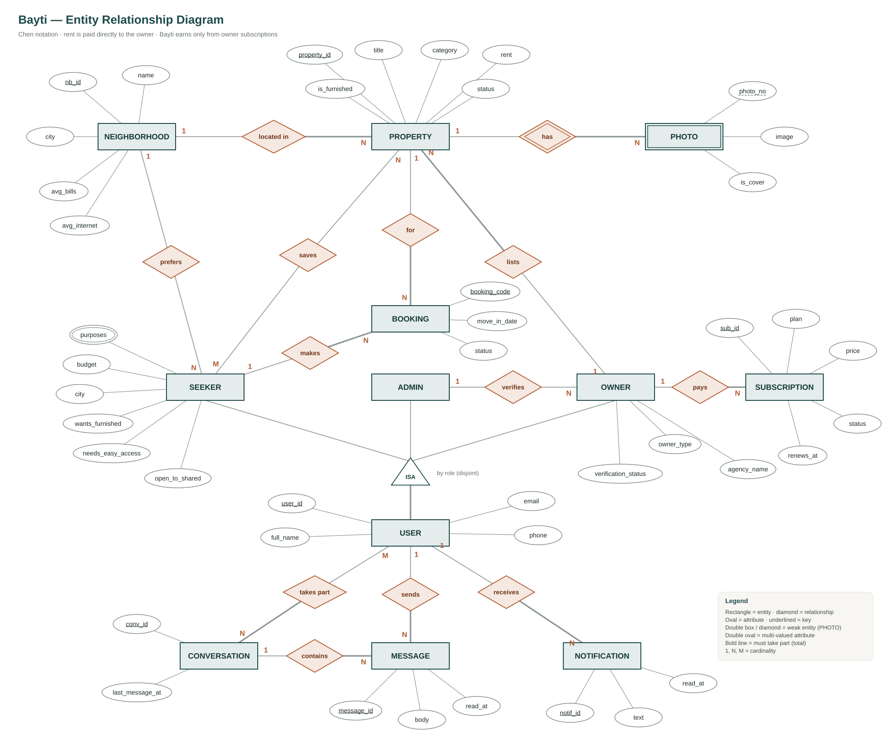

<div align="center">

# 🏠 Bayti

**Find a temporary home in Jordan that fits your life.**

Bayti ranks homes by how well they match what you need, shows the true monthly cost up front,
and connects you with verified owners.

### 🔗 Live demo: **https://ahmad-alhwari0.github.io/bayti/**

`HTML` · `CSS` · `Bootstrap 5.3` · `Bootstrap Icons` · Responsive · English (LTR)

</div>

---

## 🔑 Demo accounts

One account for each role. You can also jump straight into any role with the **Open** links.

| Role | Email | Phone | Password | Open |
|---|---|---|---|---|
| 🔎 **Home seeker** | `seeker@bayti.demo` | `0790000001` | `Bayti@2026` | [Discover homes →](https://ahmad-alhwari0.github.io/bayti/seeker/search.html) |
| 🏢 **Property owner** | `owner@bayti.demo` | `0790000002` | `Bayti@2026` | [Owner dashboard →](https://ahmad-alhwari0.github.io/bayti/owner/dashboard.html) |
| 🛡️ **Admin** | `admin@bayti.demo` | `0790000003` | `Bayti@2026` | [Admin dashboard →](https://ahmad-alhwari0.github.io/bayti/admin/dashboard.html) |

> **Note:** this release is the complete **front-end** (all screens). The backend is the next phase,
> so for now the log-in form does not check passwords — use the **Open** links above to browse each role.
> These accounts become real logins once the backend is connected.

---

## 💡 The idea

People who move to a Jordanian city for a while — students, workers, tourists, patients, people relocating —
struggle to find a place that fits them:

| Problem | How Bayti solves it |
|---|---|
| Listing sites never say whether a home **fits you** | A **match score** for every home, from three quick questions |
| Bills and internet show up **after** you move in | The **true monthly cost**: rent + bills + internet |
| Old ads and **unverified** owners | Owners are **verified** by the admin and must **confirm** their homes are still available |

## 💰 Business model

- **Free for home seekers** — no fees, ever.
- **Rent is paid directly to the owner.** Bayti never handles rent and takes **no commission**.
- Bayti earns only from **owner subscriptions**:

| Plan | Price | What you get |
|---|---|---|
| Free | 0 JOD | Up to 3 properties |
| Featured | 10 JOD / property / month | Shown first in results + "Featured" badge |
| Agency | 35 JOD / month | Unlimited properties + 5 featured listings |

---

## ✨ Features by role

### 🔎 Home seeker
- **Onboarding** — why you're coming, where you want to live (city + area), budget and needs
  (furnished, easy access, shared housing for students).
- **Discover** — *All homes* (featured first), *Matches for you* (ranked by match), and *Favorites*.
- **Property page** — photos, true monthly cost, amenities, location, owner contact (call or message),
  booking request, report a listing, neighborhood assistant.
- **My bookings** — every booking with the owner's latest update.
  Flow: **Requested → Accepted → Moved in → Completed** (completes automatically at the end date).
  A request can be cancelled only before the owner accepts.
- **Messages** with owners and Bayti Support.

### 🏢 Property owner
- **Dashboard** — key numbers, new booking requests, availability reminders.
- **My properties** and **Add property** — category (Studio, Villa, Mansion, Detached house, Apartment),
  furnished or not, photos, location, rent and bills, description in Arabic and English.
- **Booking requests** — accept or decline.
- **Messages** with home seekers and Bayti Support.
- **My account** — verification documents and subscription plan.

### 🛡️ Admin
- **Dashboard** — users, properties, subscription revenue, active subscriptions.
- **Verifications** — review owner documents, approve or reject (verified owners get a ✔ badge).
- **Users** — search, suspend, reactivate.
- **Areas** — average bills and internet per area (used for the true monthly cost).
- **Messages** with seekers and owners, each tagged **User** or **Owner**.

### 🔐 Accounts
Register as a seeker or an owner (individual or agency) · email verification code ·
log in with email or phone · Google / Apple · forgot password with an email code.

---

## 🗺️ Pages (23)

| Area | Pages |
|---|---|
| Public | [Landing](index.html) |
| Accounts | [Register](auth/register.html) · [Verify email](auth/verify-email.html) · [Log in](auth/login.html) · [Forgot password](auth/forgot-password.html) · [Reset password](auth/reset-password.html) · [Onboarding](auth/onboarding.html) |
| Seeker | [Discover](seeker/search.html) · [Property](seeker/property.html) · [My bookings](seeker/bookings.html) · [Messages](seeker/chat.html) · [Profile](seeker/profile.html) |
| Owner | [Dashboard](owner/dashboard.html) · [My properties](owner/properties.html) · [Add property](owner/property-form.html) · [Booking requests](owner/requests.html) · [Messages](owner/chat.html) · [My account](owner/account.html) |
| Admin | [Dashboard](admin/dashboard.html) · [Verifications](admin/verifications.html) · [Users](admin/users.html) · [Areas](admin/places.html) · [Messages](admin/chat.html) |

---

## 🧩 Database design



`USER` is specialized into `SEEKER`, `OWNER` and `ADMIN`. The match score and the full monthly cost
are calculated, not stored.

---

## 🛠️ Tech stack

| Layer | Used |
|---|---|
| Structure | HTML5 (semantic, accessible forms and labels) |
| Style | CSS3 with design tokens (CSS variables), Bootstrap 5.3 |
| Icons / font | Bootstrap Icons · IBM Plex Sans (self-hosted) |
| Interactivity | Bootstrap components only (tabs, dropdowns, modals, collapse, offcanvas) |
| Responsive | Desktop, tablet and phone |

## 📁 Project structure

```
bayti/
├── index.html            Landing page
├── auth/                 Register, verify email, log in, password reset, onboarding
├── seeker/               Home seeker pages
├── owner/                Property owner pages
├── admin/                Admin pages
├── assets/
│   ├── css/main.css      Design tokens and shared components
│   ├── css/pages/        Styles for seeker, owner and admin pages
│   └── fonts/            IBM Plex Sans
└── docs/ERD-chen.svg     Entity relationship diagram
```

## ▶️ Run it locally

No build step. Open `index.html` in a browser, or use the **Live Server** extension in VS Code.

---

## 🚀 Roadmap

| Phase | Scope |
|---|---|
| ✅ **Phase 1 — Front-end** | All 23 screens, responsive design, design system |
| ⏳ **Phase 2 — MVP** | Backend + database: accounts and email codes, onboarding, listings with photos, match score, true cost, booking flow, chat, owner verification, Featured subscriptions |
| 🔜 **Phase 3** | Google / Apple sign-in, neighborhood assistant, description writing assistant, map, online subscription payments, notifications by email |

---

<div align="center">

Made by **Ahmad Alhwari**

</div>
