# Bayti — Database (ERD)

12 tables. Rent is paid directly to the owner, so there are no payment or commission tables;
Bayti only earns from owner subscriptions.

```mermaid
erDiagram
  USERS ||--o| SEEKER_PROFILES : "is a seeker"
  USERS ||--o| OWNER_PROFILES : "is an owner"
  USERS ||--o{ OWNER_PROFILES : "admin reviews"
  NEIGHBORHOODS ||--o{ PROPERTIES : "located in"
  NEIGHBORHOODS |o--o{ SEEKER_PROFILES : "preferred area"
  OWNER_PROFILES ||--o{ PROPERTIES : lists
  OWNER_PROFILES ||--o{ SUBSCRIPTIONS : "pays for"
  PROPERTIES ||--o{ PROPERTY_PHOTOS : has
  SEEKER_PROFILES ||--o{ BOOKINGS : requests
  PROPERTIES ||--o{ BOOKINGS : "booked in"
  SEEKER_PROFILES ||--o{ FAVORITES : saves
  PROPERTIES ||--o{ FAVORITES : "saved in"
  USERS ||--o{ CONVERSATIONS : "takes part"
  PROPERTIES |o--o{ CONVERSATIONS : about
  BOOKINGS |o--o{ CONVERSATIONS : about
  CONVERSATIONS ||--o{ MESSAGES : contains
  USERS ||--o{ MESSAGES : sends
  USERS ||--o{ NOTIFICATIONS : receives

  USERS {
    int id PK
    string full_name
    string email UK
    string phone UK
    string password "null if Google or Apple"
    string auth_provider "email, google, apple"
    string provider_id
    string role "seeker, owner, admin"
    string avatar
    string status "active, suspended"
    string email_code "hashed 6-digit code"
    string email_code_purpose "verify_email, reset_password"
    datetime email_code_expires_at
    datetime email_verified_at
    datetime created_at
  }
  SEEKER_PROFILES {
    int user_id PK, FK
    string purposes "study, work, tourism, medical, relocation, other"
    string stay_duration
    date move_in_date
    string city
    int neighborhood_id FK "optional"
    decimal budget
    boolean wants_furnished
    boolean needs_easy_access
    boolean open_to_shared "students only"
  }
  OWNER_PROFILES {
    int user_id PK, FK
    string owner_type "individual, agency"
    string agency_name "agencies only"
    string documents "ID, title deed, power of attorney"
    string verification_status "pending, approved, rejected"
    string admin_note
    int reviewed_by FK "admin user"
    datetime verified_at
  }
  NEIGHBORHOODS {
    int id PK
    string name
    string city
    decimal avg_bills
    decimal avg_internet
  }
  PROPERTIES {
    int id PK
    int owner_id FK
    int neighborhood_id FK
    string title
    string category "studio, villa, mansion, detached_house, apartment"
    string address
    decimal latitude
    decimal longitude
    int size_m2
    int floor
    boolean is_furnished
    decimal rent
    decimal est_bills
    decimal est_internet
    text description_en
    text description_ar
    string amenities
    int min_stay_months
    date available_from
    boolean students_only
    string status "draft, active, needs_confirmation, hidden, rented"
    datetime last_confirmed_at
    boolean is_featured
    int views_count
    datetime created_at
  }
  PROPERTY_PHOTOS {
    int id PK
    int property_id FK
    string image
    boolean is_cover
    int sort_order
  }
  BOOKINGS {
    int id PK
    string booking_code UK
    int seeker_id FK
    int property_id FK
    date move_in_date
    int duration_months
    date end_date "closes the booking automatically"
    decimal agreed_rent
    string status "requested, accepted, moved_in, completed, declined, cancelled"
    datetime status_changed_at
    string cancel_reason "seeker, before acceptance only"
    datetime created_at
  }
  FAVORITES {
    int seeker_id PK, FK
    int property_id PK, FK
    datetime created_at
  }
  CONVERSATIONS {
    int id PK
    int user_one_id FK
    int user_two_id FK
    int property_id FK "optional"
    int booking_id FK "optional"
    datetime last_message_at
    datetime created_at
  }
  MESSAGES {
    int id PK
    int conversation_id FK
    int sender_id FK
    text body
    datetime read_at
    datetime created_at
  }
  SUBSCRIPTIONS {
    int id PK
    int owner_id FK
    string plan "free, featured, agency"
    decimal price
    string status "active, expired, cancelled"
    datetime started_at
    datetime renews_at
    decimal last_payment_amount
    datetime last_payment_at
  }
  NOTIFICATIONS {
    int id PK
    int user_id FK
    string type "booking, message, verification"
    string text
    string link
    datetime read_at
    datetime created_at
  }
```

## Notes

- **One profile per user:** a seeker has one `seeker_profiles` row, an owner has one `owner_profiles` row, and an admin has neither.
- **Plans are fixed** (Free 0 · Featured 10 JOD per property per month · Agency 35 JOD per month), so they live in code; `subscriptions.plan` stores the name.
- **Reports** ("Report this listing", "Report a problem") arrive as messages to Bayti Support, so they need no table.
- **Calculated, not stored:** match score, full monthly cost (rent + bills + internet), unread counts.
- **Multi-value columns:** `purposes`, `amenities` and `documents` can be JSON columns, or small tables of their own later.
